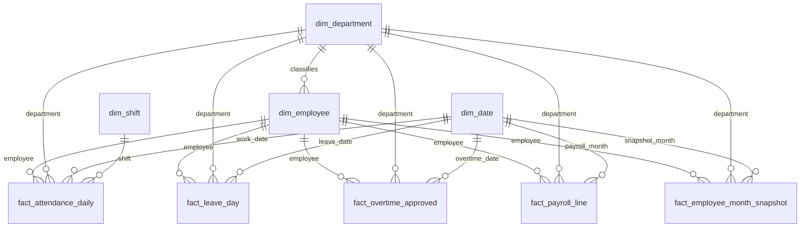

# Warehouse Data Model

The warehouse uses shared dimensions across attendance, leave,
overtime, payroll, and employee-month snapshots.

## Relationships

## Table grains and keys

| Table | One row represents | Primary key |
|---|---|---|
| dim_department | One department | department_key |
| dim_shift | One shift definition | shift_key |
| dim_date | One calendar date | date_key |
| dim_employee | One effective-dated employee history version | employee_key |
| fact_attendance_daily | One employee on one work date | employee_key, date_key |
| fact_leave_day | One eligible approved leave day per request | request_id, date_key |
| fact_overtime_approved | One approved overtime request | request_id |
| fact_payroll_line | One payroll component line | line_id |
| fact_employee_month_snapshot | One employee per reporting month | emp_id, month_date_key |

## Historical employee tracking

dim_employee implements Slowly Changing Dimension Type 2.

- emp_id identifies the employee across history versions.
- employee_key identifies a specific history version.
- valid_from and valid_to define the inclusive validity interval.
- The latest version has valid_to = NULL and is_current = 1.
- is_current identifies the latest history version, not employment status.
- Facts reference the employee version applicable to their attribution date.

## Department attribution

- Attendance, leave, and approved overtime use the department
  applicable on the work, leave, or overtime date.
- Payroll and monthly snapshots use the department at month-end,
  or the last working day when the employee has separated.
- Monthly analytical comparisons use the employee-month snapshot
  to apply consistent monthly department attribution.

## Date roles

- Attendance date_key represents the shift's work date.
- Night-shift attendance belongs to the date the shift starts.
- Leave and approved overtime date_key represent their applicable date.
- Payroll payroll_month_key and snapshot month_date_key reference
  the first calendar date of the reporting month.